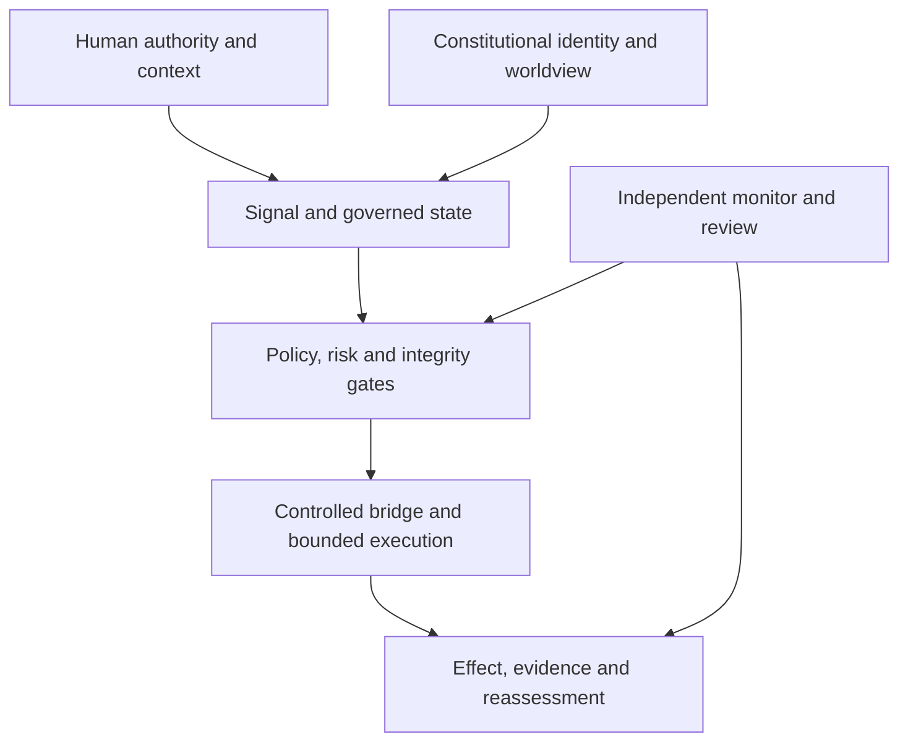

# Architecture

## Layered flow

The bootstrap layer places the Engineering Postulate of Subjectivity beneath
Constitutional Identity. Sufficiently autonomous systems are therefore engineered
as if they maintain a Subjective State (Engineering Model), while the standard
remains neutral on machine consciousness. The
[constitutional and relational layer](constitutional-and-relational-layer.md)
is interpretive: worldview or personality cannot directly authorize an effect.
Operational consequences cross a traceable translation boundary into policies,
gates, tests, external enforcement, and evidence.

The [technical oversight protocol](assurance-evaluation-and-technical-oversight.md)
wraps this flow with declaration, risk classification, reproducible measurement,
independent review where required, incident accounting, and reassessment after
material change.

## Explain Like a 10-Year-Old

Think of the AI like a robot at school.
It hears a request (signal), remembers class rules (state), checks its core promise (Constitutional Identity), asks a teacher if needed (safety gates),
then uses a safe door (bridge) to do the task.
Every step is written in a notebook (audit log).

## Integration Steps

1. Define your system signals.
2. Define state fields needed for decisions, including any Subjective State (Engineering Model) needed for autonomous continuity.
3. Define the Constitutional Identity and Protected Core.
4. Add Mission Continuity and Epistemic Integrity checks before high-impact actions.
5. Add relational safety, objective-scope integrity, and knowledge admission checks when the deployment profile needs them.
6. Add bridges for each tool/API with authorization scope.
7. Put safety gates before every bridge action and external side-effect check before action.
8. Save an evidence record with a short explanation for every action.
9. Freeze an assurance run manifest, execute applicable negative,
   counterfactual, positive-control, mutation, and formal tests, and publish only
   the claim level supported by the retained evidence.
